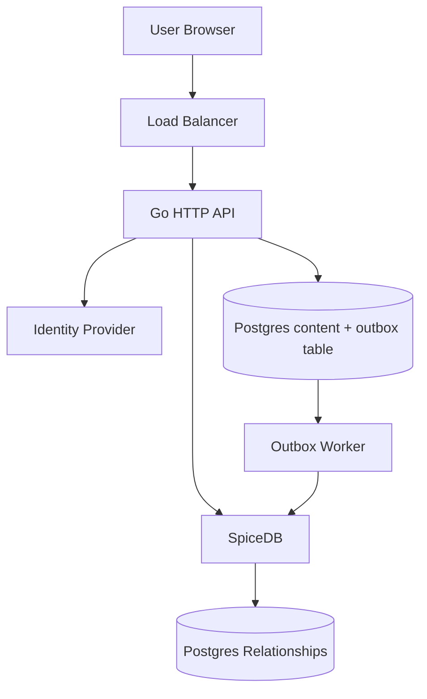
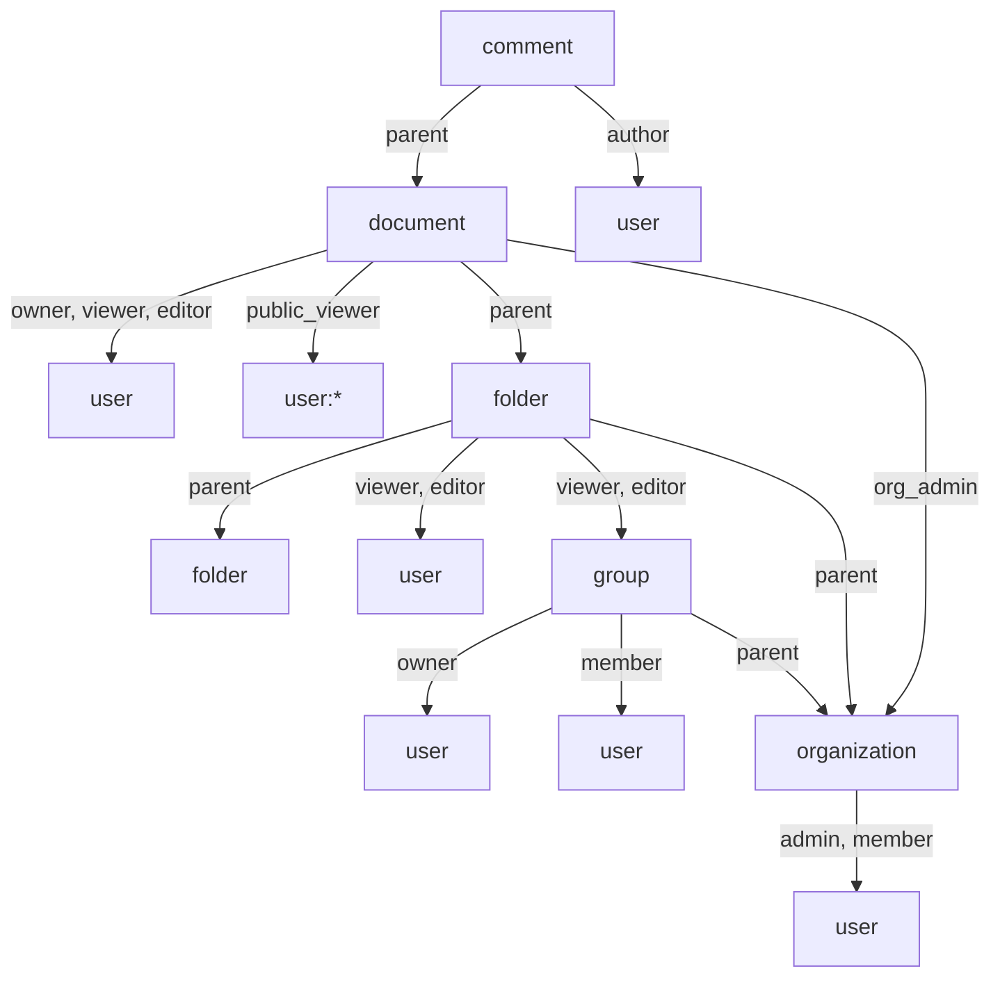

# Docsio-SpiceDB

## Description

This is a Multi-Tenant SasS Authorization microservice, that implements a transactional outbox pattern.
It handles application permissions using a separate postgres permission database.
This closely follows
[Google Zanzibar](https://research.google/pubs/zanzibar-googles-consistent-global-authorization-system/)
Authorization system. The main point being that Authorization is a ReBAC design (Relationship Based Access Control),
where a user's acces to a resource is based on their relationship to other parent resources.
This allows the permissions of resources to inherit from internal folders, to internal groups, to tenant/company members.
Which can simplify what would be difficult using authorization based or roles alone.

This project is not something that I made by myself, but I was looking for a more secure and auditable way to handle permissions.
All credit for this project goes to Nithin Bharadwaj of [EliteDev](https://elitedev.in) for outlining the project and providing code examples in his book...

- "Building Permission Systems with SpiceDB and Go: A Hands-On Guide to Zanzibar-Inspired Authorization for Production SaaS"

This application has a 6 parts to it's architecture...

- An HTTP API (go, chi router, JSON over HTTPS) exposing endpoints for orgs, folders, documents, sharing
- Postgres as the primary database for content -- document bodies, folder names, organization metadata
- SpiceDB to handle authorization
- An outbox table in Postgres - to sync writes to SpiceDB (Transactional Outbox Pattern)
- A worker that drains the outbox and applies tuples to SpiceDB

A graph of this archetecture is...



Now the main resource being authorized is documents. With the following permissions that are direct to the document or inherited by other relationships...

- read -- direct viewer/editor/owner, public link with expiry, or inherited from the folder
- write -- direct editor/owner or inherited from the folder
- delete -- direct owner or organization admin
- share -- direct owner or organization admin
- comment -- anyone who can read can also comment

The entire relationship graph from child to parent is this...



All permissions in this project are derived from this graph of relationships above.

## Getting Started

### Main Dependencies

- [docker cli](https://github.com/docker/cli) v29.9.2 or newer (needed as a base to build the database contianers and SpiceDB)
- [docker compose](https://github.com/docker/compose) v5.6.1 or newer (needed to build the project based on the docker-compose.yml file)
- [go](https://github.com/golang/go) v1.27.3 or newer (the backend programming language used to run our API)

### Go Package Dependencies

- [authzed-go](https://github.com/authzed/authzed-go) v1.11.0 (SpiceDB SDK)
- [authzed/grpcutil](https://github.com/authzed/grpcutil) v0.0.0 (Auth and TLS gRPC helpers for SpiceDB SDK)
- [chi](https://github.com/go-chi/chi) v5.5.0 (for a routing framework)
- [pgx](https://github.com/jackc/pgx) v5.9.1 (for a golang postgres driver)
- [golang-jwt](https://github.com/golang-jwt/jwt) v5.3.1 (for jwt token sessions)
- [backoff](https://github.com/cenkalti/backoff) v4.3.0 (for retry of transient errors)
- [testify](https://github.com/stretchr/testify) v1.12.1 (for testing assertions)
- [dockertest](https://github.com/ory/dockertest) v3.12.0 (for integration testing on real Postgres/SpiceDB)

### Installing manually

> **WARNING:**
> These instructions assume you are running this project on a linux operating system and building using your machine's command line
> It is also assumed you already have some experience building Go projects and building applications with Docker.

The first step is adding environment variables please copy the [example](.env.example) and save as a .env file to your project.
You would then add those valiables to your local dev environment by entering on your command line...

```bash
set -a
source .env
set +a
```

Another thing is that for regular development the gRPC for spicedb still uses an ssl certificate,
but we just do not verify the certeficate while in development. This certificate and key need to be
placed in the certs folder of the project. The certificates will automatically be used by SpiceDB
after creating the container in Docker. To create a simple development certifacate, please enter the
following command in the main project folder...

```bash
openssl req -x509 -out certs/tls.crt -keyout certs/tls.key \
  -newkey rsa:2048 -nodes -sha256 \
  -subj '/CN=localhost' -extensions EXT -config <( \
   printf "[dn]\nCN=localhost\n[req]\ndistinguished_name = dn\n[EXT]\nsubjectAltName=DNS:localhost,IP:127.0.0.1\nkeyUsage=digitalSignature\nextendedKeyUsage=serverAuth")
```

Creating the project involves running docker compose based on the [file](docker-compose.yml)
provided in the project. Enter the following in your command line...

```bash
docker compose up -d
```

You now have a working SpiceDB and Postgres database. To check if everything is working
you can run this in your command line...

```bash
docker ps
```

Now all that needs to be done is to build the Go API backend. Begin by installing package
dependencies running in the command...

```bash
go mod tidy
```

You can run the backend application using this command in the main project folder...

```bash
go run ./...
```

### Authors

Max Kranker

## Version History

### Pre-Release v0.\*.\*

<details>
<summary>Click To Expand Releases</summary>

- 0.1.0
  - initial commit
- 0.2.0
  - update readme to include tls cert instructions
- 0.3.0
  - move schema zed files to be internal to go project
- 0.4.0
  - add authorization service defitinion as "Client" interface
- 0.5.0
  - add spicedb client implementation
- 0.6.0
  - update docker compose to create goose migrations and add db healthchecks
- 0.7.0
  - migrate to add permissions_outbox table
- 0.8.0
  - migrate to add doc_shares table
- 0.9.0
  - add GOOSE_MIGRATION_DIR to .env.example
- 0.10.0
  - add docs service Doc model
- 0.11.0
  - add docs service DocShare model
- 0.12.0
  - migrate to add docs table to database
- 0.13.0
  - create docs service store interface with postgres and ShareDoc method
- 0.14.0
  - create docs service store interface with postgres and ShareDoc method
- 0.15.0
  - fix down migration sql errors
- 0.16.0
  - add pgx database driver package along with tests

</details>

## License

See the LICENSE.md file for details
